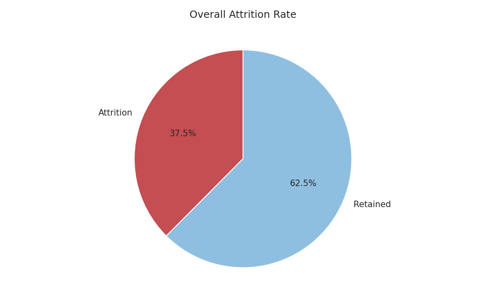
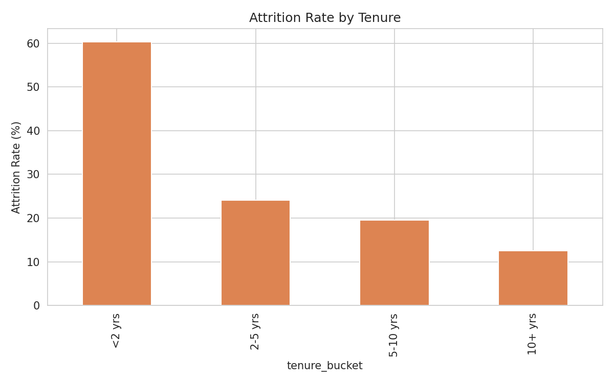

# HR Employee Attrition Analysis

An end-to-end data analysis project that looks at why employees leave a company. I generated a year's worth of synthetic HR data for 1,500 employees, deliberately made it messy the way a real HR export often is, then cleaned it and analyzed it with Python and SQL to find the biggest drivers of attrition — the same workflow I'd use for an actual company dataset.

**Author:** Umesh Rajak
📧 ur71289@gmail.com | 📍 Bhopal, Madhya Pradesh

---

## Why this project

Employee attrition is one of the most common problems HR and analytics teams are asked to investigate. I wanted a project that mirrors that: raw, imperfect data → a documented cleaning process → SQL and Python analysis → clear, decision-ready insights.

## Project structure

```
hr-attrition-analysis/
├── data/
│   ├── raw_hr_data.csv          # Messy, uncleaned export (the "before")
│   └── cleaned_hr_data.csv      # Analysis-ready data (the "after")
├── src/
│   ├── generate_raw_data.py     # Creates the synthetic raw dataset
│   ├── clean_data.py            # All the data cleaning logic
│   └── analyze_attrition.py     # EDA + chart generation + printed insights
├── sql/
│   └── attrition_queries.sql    # 9 SQL queries (aggregations, ranking, window functions)
├── visuals/
│   ├── attrition_rate_overview.png
│   ├── attrition_by_department.png
│   ├── attrition_by_tenure.png
│   └── attrition_by_salary.png
├── requirements.txt
└── README.md
```

## The data cleaning step

The raw file has the kind of problems a real HR export usually has:

- Inconsistent text casing and stray whitespace in department names (`" marketing "` vs `Marketing`)
- 30 duplicate employee rows, as if the export ran twice
- Missing values in `monthly_salary`, `job_satisfaction`, `performance_rating`, and `overtime`
- A few negative `tenure_years` values and `age = 0` entries from data-entry errors

`src/clean_data.py` standardizes text, removes duplicates by `employee_id`, fixes impossible values, and imputes missing numeric fields using the median **within each department** (falling back to the overall median). 1,530 raw rows go in, 1,500 clean rows come out.

## Key insights (from this run)

- **Overall attrition rate:** 37.5%
- **Tenure is the single biggest driver:** employees with less than 2 years of tenure leave at 60.3%, compared to 12.5% for employees with 10+ years
- **Salary matters:** the Low salary band has a 53.3% attrition rate vs. 31.7% for the High band
- **Overtime employees leave at nearly 1.5x the rate** of those without overtime (48.2% vs 33.1%)
- **Highest-risk department:** Marketing (43.0%), **lowest-risk:** Sales (34.8%)

*(Since the dataset is randomly generated, exact numbers will shift slightly if you regenerate it — the point is the pipeline and the pattern, not these precise figures.)*

## How to run it

```bash
# 1. Install dependencies
pip install -r requirements.txt

# 2. Generate the raw (messy) dataset
python src/generate_raw_data.py

# 3. Clean it
python src/clean_data.py

# 4. Run the analysis and generate charts
python src/analyze_attrition.py
```

Charts land in `visuals/`, and the SQL in `sql/attrition_queries.sql` can be run against `cleaned_hr_data.csv` in SQLite, MySQL, or Postgres (load the CSV into a table named `employees` first). The cleaned CSV can also be loaded directly into Power BI for an interactive dashboard version.

## Sample output

**Overall Attrition Rate**



**Attrition by Tenure**



## Tools used

- **Python** (pandas, numpy, matplotlib, seaborn) — data generation, cleaning, analysis, visualization
- **SQL** — aggregations, grouping, and window functions
- **Excel / Power BI** — the cleaned CSV is ready to load straight into Power BI for slicers and an interactive dashboard

## What I'd add next

- Build an actual Power BI dashboard on top of the cleaned data with slicers for department and tenure band
- Add a simple logistic regression model to predict attrition probability per employee
- Automate the full pipeline with a single script or scheduled job

---

If you have feedback or spot something I could do better, I'd genuinely like to hear it.
